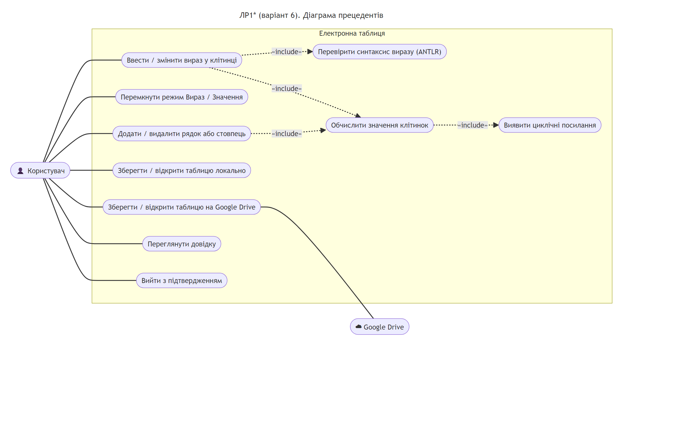
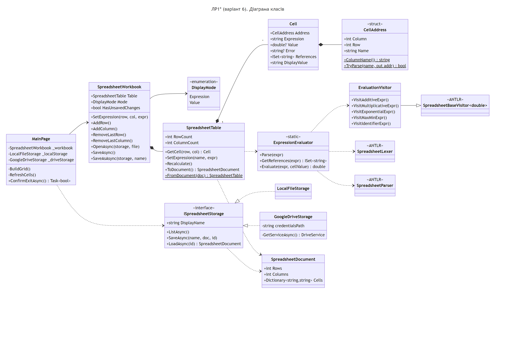
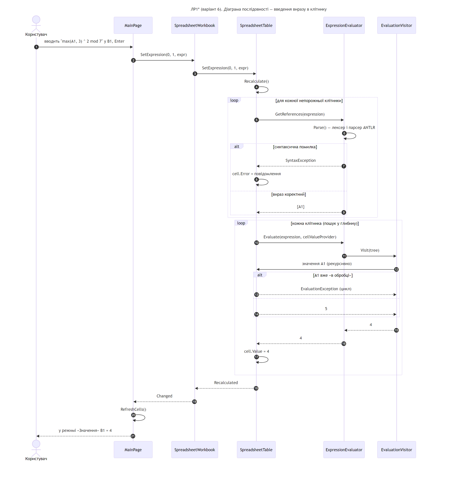

# Лабораторна робота №1* — Електронна таблиця з роботою з Google Drive

Варіант 6: операції `+ - * /` (бінарні), `mod`, `div`, `^` (піднесення у степінь), `max(x, y)`, `min(x, y)`.
Вирази арифметичні, значення клітинки є числом.

## Можливості

- таблиця з додаванням і видаленням рядків та стовпців (з попередженням, якщо на видалені клітинки є посилання);
- вирази з цілих чисел, круглих дужок, посилань на клітинки (`A1`, `B12`) та операцій варіанту;
- синтаксичний аналіз граматикою ANTLR4 (`src/Spreadsheet.Core/Grammar/Spreadsheet.g4`) з локалізацією помилки;
- обчислення з урахуванням залежностей між клітинками, виявлення циклічних посилань, ділення на нуль тощо;
- два режими відображення: **Вираз** / **Значення**, рядок формул для вибраної клітинки;
- збереження та відкриття таблиць у власному форматі JSON локально (`Документи\Lab1Spreadsheets`) і **на Google Drive** (папка `Lab1Spreadsheets`);
- україномовний інтерфейс, довідка, підтвердження виходу ("Чи дійсно ви хочете завершити роботу з програмою?").

## Структура

| Проєкт | Призначення |
|---|---|
| `src/Spreadsheet.Core` | Граматика ANTLR, обчислення виразів, модель таблиці, сховища (локальне, Google Drive) |
| `src/Spreadsheet.App` | Інтерфейс користувача на .NET MAUI (Windows) |
| `tests/Spreadsheet.Core.Tests` | Unit-тести xUnit (32 тести) |
| `docs/uml` | UML-діаграми: прецедентів, класів, послідовності (Mermaid + PNG) |

Логіка винесена з обробників кнопок у класи `SpreadsheetWorkbook` і `SpreadsheetTable`, щоб уникнути антишаблону «магічна кнопка».

## Запуск

Потрібні .NET 8 SDK і робоче навантаження MAUI (`dotnet workload install maui-windows`).

```bash
dotnet test tests/Spreadsheet.Core.Tests
dotnet build src/Spreadsheet.App -f net8.0-windows10.0.19041.0
dotnet run --project src/Spreadsheet.App -f net8.0-windows10.0.19041.0
```

## Google Drive

Для роботи з Google Drive потрібен OAuth-клієнт типу **Desktop app**:

1. Google Cloud Console → створити проєкт → увімкнути **Google Drive API**.
2. APIs & Services → Credentials → Create credentials → OAuth client ID → Desktop app.
3. Завантажити JSON і покласти його як `credentials.json` поруч із `Spreadsheet.App.exe`
   (або в `src/Spreadsheet.App/credentials.json` — файл копіюється під час збірки і не потрапляє в git).

Під час першого збереження відкриється браузер для входу в Google. Програма використовує область доступу
`drive.file`, тобто бачить лише файли, які створила сама.

## UML

| Прецеденти | Класи | Послідовність |
|---|---|---|
|  |  |  |

## Відео з демонстрацією

[docs/video/demo.mp4](docs/video/demo.mp4): показ коду, запуск тестів і робота програми.
